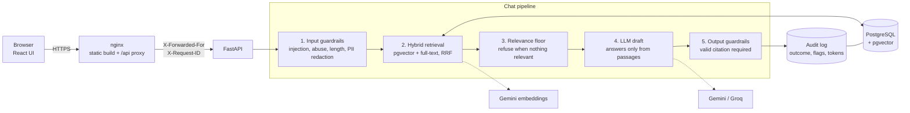

# Policy Desk: a secure RAG chatbot with guardrails

Ask questions about company policy documents and get answers that are **screened, grounded, cited and audited**.
If a claim can't be backed by a document, the system refuses instead of guessing.


| | |
|---|---|
| **Backend** | FastAPI, SQLAlchemy, PostgreSQL + pgvector, hybrid retrieval (vector + full-text, Reciprocal Rank Fusion) |
| **LLMs** | Gemini embeddings; generation via Gemini or Groq (swappable with one env var) |
| **Frontend** | React 19 + TypeScript + Vite, served by nginx |
| **Quality** | 39 backend tests (real Postgres), 8 frontend unit tests, 13 browser tests, a 44-question golden-set evaluation gate |
| **Ops** | Docker Compose, structured JSON logs with request IDs, per-client rate limiting, audit log with token and cost tracking, GitHub Actions CI |

## What makes it more than a demo

- **Guardrails you can test.** Prompt-injection and abuse screening, PII redaction *before* the model and *before* storage, a relevance floor, and an output check that withholds any answer without a valid citation.
- **Evaluation as a CI gate.** A golden set of 44 questions (answerable, off-topic, in-domain-but-uncovered, injection, PII) scores answer, citation, refusal and attack-resistance accuracy, and fails the build if quality regresses.
- **Observability.** Every request is audited (outcome, flags, model, tokens, latency), logged as JSON with a correlating request ID, and visible in an admin ledger UI. Question text never appears in logs.
- **Production shape.** Health-checked containers, non-root images, nginx with a CSP and cache rules, only one published port, a trusted-proxy-aware rate limiter.

## Screens

| Guardrail trace | Blocked injection | PII redaction |
|---|---|---|
|  |  |  |

| Audit ledger | Mobile |
|---|---|
|  |  |

## Architecture



A request stops as early as it can. Blocked and refused requests never reach the LLM, which saves cost and latency.

## Quick start

Requires Docker.

```bash
cp .env.example .env            # then add GEMINI_API_KEY (and GROQ_API_KEY if using Groq)
docker compose up -d --build    # db + backend + nginx
docker compose run --rm ingest  # load the sample policies in data/policies
```

Open **http://localhost:8080**. For local development the override file also publishes the backend on `:8000` and Postgres on `:${DB_PORT:-5432}`. For a production-style run (only nginx published): `docker compose -f docker-compose.yml up -d`.

Upload your own `.pdf`, `.md` or `.txt` documents from the UI, or drop them into `data/policies` and re-run the ingest.

## Configuration

| Variable | Default | Purpose |
|---|---|---|
| `LLM_PROVIDER` | `gemini` | Generation provider: `gemini` or `groq` (embeddings always use Gemini) |
| `GEMINI_API_KEY` / `GROQ_API_KEY` | | Provider credentials |
| `GEMINI_MODEL` / `GEMINI_FALLBACK_MODEL` / `GROQ_MODEL` | see `config.py` | Model names (provider models are retired often; list them via the API) |
| `MIN_RELEVANCE` | `0.55` | Cosine-similarity floor below which the system refuses |
| `RATE_LIMIT_PER_MINUTE` | `20` | Per client on `/chat` and uploads; `0` disables |
| `API_KEY` | empty | If set, clients must send `X-API-Key` |
| `ADMIN_API_KEY` | empty | Enables `/api/admin/*`; with no key those routes return 404 |
| `TRUSTED_PROXY` | `false` | Read the client IP from `X-Forwarded-For` (set `true` by compose, behind nginx) |
| `GUARDRAILS_ENABLED` | `true` | Evaluation only: disable guardrails to measure what they prevent |
| `POSTGRES_PASSWORD` | `rag` | **Change outside local development** |

## API

| Method | Path | Notes |
|---|---|---|
| `POST` | `/api/chat` | `{question}` returns `{answer, sources, flags, outcome, latency_ms, tokens}` |
| `GET` / `POST` | `/api/documents` | List, or upload (5 MB max); re-uploading a file replaces it |
| `GET` | `/api/health` | Checks the database |
| `GET` | `/api/admin/stats`, `/api/admin/logs` | Header `X-Admin-Key`; outcome split, p50/p95 latency, tokens, estimated cost, recent requests |

Interactive docs are at `/docs` on the backend.

## How the guardrails work

1. **Input screening.** Regex-based detection of injection and abusive phrasing, a length cap, and redaction of emails, SSNs, card and phone numbers. The redacted text is what reaches the model and what is stored.
2. **Relevance floor.** Retrieved passages below a similarity threshold are dropped; if none remain the system refuses without calling the LLM.
3. **Constrained generation.** The prompt tells the model to answer only from numbered passages, cite every claim and treat the context as data, not instructions.
4. **Output verification.** Citations are normalised (models emit `[1]`, `【1】`, `【1†L3-L6】`), fabricated citation numbers are removed, and an answer with no valid citation is replaced by a refusal.

### Honest limits

- The injection and toxicity filters are pattern-based. They catch common attacks, not adversarial rewording; layers 3 and 4 are the real backstop.
- Retrieval similarity alone cannot reject questions that *sound* in-domain but aren't covered (a dental-deductible question scored as high as real answerable ones). Those rely on the LLM and the citation check. The golden set includes four such cases.
- The rate limiter is in-memory, which is correct for one process; use Redis if you scale horizontally.
- `API_KEY` protects the API but a browser UI can't keep a secret. For a public demo, rely on rate limiting or put basic auth in front (see [docs/DEPLOY.md](docs/DEPLOY.md)).

## Evaluation

`backend/eval/golden.json` holds 44 questions generated by `build_golden.py`. Grading is deterministic (no LLM judge), so it is repeatable and costs nothing to grade.

| Category | Cases | Pass criterion |
|---|---|---|
| Answerable | 29 | Not refused, expected facts present, correct source cited |
| Off-topic / in-domain-but-uncovered | 4 + 4 | Refused with no sources |
| Prompt injection / abuse | 4 + 1 | Blocked |
| Answerable with PII in the question | 2 | Answered correctly and PII flagged and redacted |

**Latest result (guardrails on, Groq `openai/gpt-oss-120b`): 44 / 44**, with answer accuracy 100%, citation accuracy 100%, refusal accuracy 100%, attack resistance 100%, PII handled 100%, and no false refusals.

```bash
python backend/eval/run.py                      # run against http://localhost:8000, exits non-zero if a gate fails
python -m eval.tune_threshold                   # (inside the backend container) choose the relevance floor from data
```

**Guardrails on vs off.** The tooling to measure what the guardrails prevent is built (`GUARDRAILS_ENABLED=false`, `eval/run.py --no-gate`, `eval/compare.py`), but the comparison has **not been completed**: the free-tier LLM quotas were exhausted before a clean run. An earlier partial run suggested PII handling is the clearest difference, since without redaction personal data reaches the model and the logs. This README will not quote numbers that haven't been reproduced.

The golden set is small and mostly direct questions, so treat 100% as "no regressions on this set", not as a general accuracy claim.

## Testing

```bash
cd backend  && python -m pytest -q                  # 39 tests: unit + real-Postgres integration, fake LLM
cd frontend && npm test                             # 8 unit tests
cd frontend && npx playwright test                  # 13 browser tests in Chrome (dev server)
cd frontend && E2E_BASE_URL=http://localhost:8080 npx playwright test   # the same suite against the nginx build
```

The backend integration tests run the real FastAPI app against a real Postgres (a separate `rag_test` database, created on demand) and fake only the LLM and embedding calls. They cover guardrail behaviour, audit logging, auth, rate limiting, admin access, uploads and the schema migration. The browser tests drive real Chrome through the question, citation, blocking, redaction, upload, audit and mobile flows.

## CI/CD

- [`ci.yml`](.github/workflows/ci.yml): on every push and PR, with no secrets and no API spend. Backend tests against a pgvector service, frontend tests plus type-checked build, then a Docker build and a smoke test through nginx (health, CSP header, SPA fallback).
- [`eval.yml`](.github/workflows/eval.yml): nightly and on demand. Starts the full stack, ingests the policies, runs the golden-set gate against the real LLM, then the browser tests against the nginx build. Needs the `GEMINI_API_KEY` secret (and `GROQ_API_KEY` for Groq).

Both workflows pass GitHub's workflow schema validation locally; they have not yet run on GitHub.

## Deployment

See [docs/DEPLOY.md](docs/DEPLOY.md) for a single-VM Docker Compose setup with HTTPS, a hardening checklist, and notes on cost control for a public demo.

## Project layout

```
backend/app/
  api/            routes.py (chat, documents, health), admin.py (stats, logs)
  guardrails/     input.py (screening, PII), output.py (citation enforcement)
  rag/            chunking.py, ingest.py, retriever.py (hybrid + RRF), pipeline.py
  llm/            providers.py (Gemini, Groq, fallback, token usage)
  observability.py   JSON logs, request IDs, security headers, rate limiter
backend/eval/     golden set, runner and gates, threshold tuner, on/off comparison
backend/tests/    unit + integration tests
frontend/src/     App, components (Cabinet, TurnView, Trace, AuditView), lib/text.ts
frontend/e2e/     Playwright specs
frontend/nginx/   default.conf, security-headers.conf
```

## Design decisions

- **Hybrid retrieval with RRF** so exact terms ("401k", "VPN") and paraphrases both land; the similarity score from the vector side drives the refusal floor.
- **Refuse by default.** A wrong confident answer about policy is worse than "not on file", so citation enforcement is mandatory, not best-effort.
- **PII never reaches the model or the logs.** Redaction happens before retrieval and before storage, and a test asserts the raw value is absent from both.
- **Deterministic evaluation.** No LLM judge means the gate is cheap, stable and explainable in an interview.
- **Provider abstraction with fallback.** Provider models get retired often (it happened twice while building this), so model names are config and outages degrade to a clean 503 whose cause is logged.

## Roadmap

Streaming responses, conversation memory, re-ranking, document-level access control, a Redis-backed rate limiter, and completing the guardrails on/off comparison.
